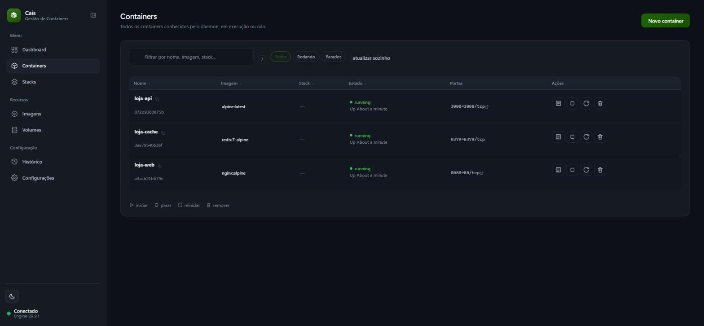
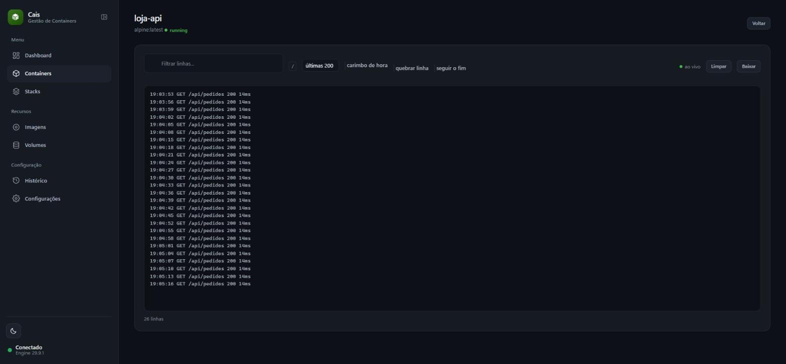
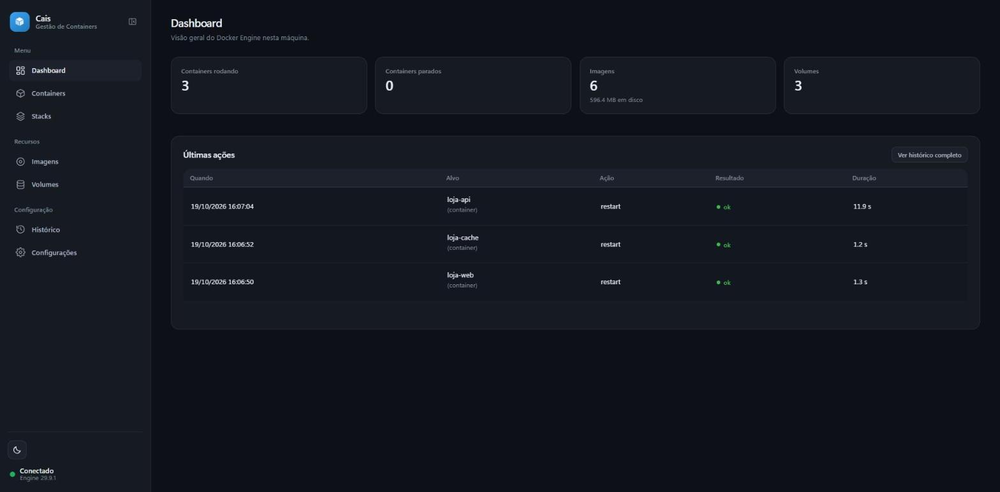

# Cais

Um painel web para gerenciar containers Docker. É um `.exe` de 13 MB — baixa,
dá duplo clique, abre no navegador. Não tem instalador, não pede login, não
precisa de runtime nenhum.



## Por que isso existe

Quem roda o Docker Engine direto, sem interface gráfica em cima, acaba fazendo
tudo pela linha de comando. Funciona, mas é um baque no dia a dia — sobretudo
para quem não é de infraestrutura e só quer ver se o container subiu, olhar um
log ou reiniciar um serviço.

O Cais é uma alternativa leve para esse uso. Não tenta ser uma plataforma: não
gerencia Kubernetes, não tem marketplace de extensão, não sincroniza nada com
nuvem. Faz o arroz com feijão de quem mexe com container todo dia, e faz rápido.

> Não tem ligação nenhuma com a Docker, Inc. É só um cliente da Engine API.
> Detalhes em [NOTICE.md](NOTICE.md).

## O que ele faz

**Containers** — lista com estado, portas e stack de origem. Inicia, para,
reinicia e remove. Cria container novo por formulário: imagem, nome, portas,
variáveis de ambiente, volumes, política de reinício e comando. Porta publicada
vira link clicável, então `8080` abre o serviço direto.

**Logs ao vivo** — o recurso que mais economiza terminal no dia a dia. Filtro de
linha, escolha de quantas linhas carregar, carimbo de hora, seguir o fim e botão
para baixar tudo.



**Stacks do Compose** — você aponta para um `docker-compose.yml` e controla
subir, reiniciar e derrubar pela tela. O arquivo é validado no cadastro, então
compose quebrado é recusado na hora em vez de falhar depois.

**Imagens e volumes** — baixar imagem com barra de progresso, remover, criar
volume. Tudo o que normalmente exigiria decorar flag de CLI.

**Histórico** — toda operação feita pelo painel fica registrada com resultado,
duração e erro. Já me salvou: containers sumiram, olhei o histórico e estava lá
quem rodou o `down` e quando.



Fora isso: busca e ordenação em todas as tabelas, tema claro e escuro, menu
retrátil, atalhos de teclado (`/` busca, `b` recolhe o menu) e cor de destaque
configurável.

## O que falta

Duas coisas, e vale saber antes de instalar:

- **Terminal dentro do container.** Para entrar num container ainda é
  `docker exec -it <nome> sh`.
- **CPU e memória ao vivo.** A lista mostra estado e portas, mas não consumo.

## Instalar

Pegue o `.exe` na página de [releases](../../releases) ou compile:

```bash
git clone https://github.com/YuriBertoldi/Cais.git
cd Cais
go build -o cais.exe .
```

Se baixou da internet, o Windows pode bloquear o executável por não ser
assinado. Resolve com `Unblock-File .\cais.exe` no PowerShell.

## Antes de rodar: o Docker precisa estar acessível

O Cais não embute motor nenhum. Ele conversa com um Docker Engine que já exista,
pela Engine API, por um de dois transportes:

| Transporte | `-docker-host` | Exige |
|---|---|---|
| TCP | `tcp://127.0.0.1:2375` (padrão) | Daemon escutando em TCP, **sem autenticação** |
| WSL (`dial-stdio`) | `wsl://<distro>` | Só o `docker` instalado na distro WSL |

### Opção sem abrir porta: `wsl://`

No Windows com WSL2 dá para não expor porta nenhuma. Com
`-docker-host wsl://Ubuntu-24.04`, o Cais executa
`wsl.exe -d Ubuntu-24.04 --exec docker system dial-stdio` e fala com o daemon
pelo stdin/stdout desse processo, o mesmo transporte que o próprio Docker usa em
`ssh://`. O daemon continua só no socket Unix, e só quem consegue executar o
`wsl.exe` na sessão do usuário alcança a Engine API.

```bash
cais -docker-host wsl://Ubuntu-24.04 -wsl-distro Ubuntu-24.04
```

`wsl://` sem nome usa a distro padrão do WSL. Cada conexão da API é um processo
`wsl.exe`, encerrado quando a conexão fecha.

### Opção TCP

Se preferir TCP e o seu daemon ainda não escuta nele, crie
`/etc/systemd/system/docker.service.d/override.conf`:

```ini
[Service]
ExecStart=
ExecStart=/usr/bin/dockerd -H fd:// -H tcp://127.0.0.1:2375
```

Um aviso que economiza meia hora: **não adianta colocar `hosts` no
`daemon.json`**. A unit do systemd já passa `-H fd://`, e o daemon se recusa a
subir reclamando que o host foi definido em dois lugares. Tem que ser pelo
drop-in acima.

No Windows com WSL2, mesma coisa dentro da distro — o encaminhamento de
`localhost` do WSL resolve o resto.

### Leia isto antes de abrir a porta

A 2375 **não tem autenticação e dá acesso equivalente a root** na máquina do
daemon. Quem alcança essa porta sobe um container privilegiado com o disco do
host montado e acabou.

Use `127.0.0.1`. Nunca `0.0.0.0`. Em rede que você não controla, não habilite.

## Usar

```bash
cais              # sobe e abre o navegador
cais -dev         # recarrega template a cada request, para desenvolver
```

Dar duplo clique duas vezes não abre dois processos: o segundo percebe que já
tem um rodando, abre o navegador nele e sai de cena.

| Opção | Padrão | Para quê |
|---|---|---|
| `-porta` | `45678` | Porta de escuta. `0` pega qualquer uma livre |
| `-docker-host` | `tcp://127.0.0.1:2375` | Onde está a Engine API: `tcp://host:porta` ou `wsl://distro` |
| `-wsl-distro` | `Ubuntu-24.04` | Distro usada para rodar o `docker compose` |
| `-no-browser` | — | Não abrir o navegador ao iniciar |
| `-db` | `%LOCALAPPDATA%\Cais\painel.db` | Banco local |
| `-dev` | `false` | Lê template e CSS do disco |

## Segurança

Não tem login, e isso é de propósito: é uma ferramenta de um usuário só, na
própria máquina. Senha ali seria teatro. A proteção é outra:

O servidor escuta só em `127.0.0.1`. Todo request tem `Host` e `Origin`
conferidos, o que fecha a porta para DNS rebinding — aquele ataque em que um
site qualquer resolve um domínio para `127.0.0.1` e passa a falar com o que
roda na sua máquina. E todo `POST` exige um token CSRF gerado por processo.

Nenhuma rota repassa chamada crua para o daemon. Cada operação é nomeada e está
numa lista explícita; não dá para inventar endpoint pela URL.

## Como é por dentro

Go com `net/http` e `html/template`. Sem framework, sem build de front-end.

```
main.go          listener, instância única, abre o navegador, encerra limpo
embed.go         go:embed de templates/ e static/
internal/
  config/        flags e caminho do banco
  docker/        cliente da Engine API
  compose/       roda o Compose dentro do WSL
  store/         SQLite: migrations, preferências, stacks, histórico
  models/        entidades e dados de página
  handler/       controllers, middlewares, tema
templates/       base.html + 10 páginas
static/          app.css, app.js, icons.svg, vendor/
```

### Três decisões que talvez surpreendam

**Não usei o SDK oficial do Docker.** Ele traz uns 60 módulos transitivos e
engorda o binário em 20–25 MB para cobrir uma API inteira, quando o Cais usa uns
15 endpoints. O que o SDK resolveria e não é trivial — sequestrar a conexão para
o `exec` e desmultiplexar o stream de log — deu umas 100 linhas, escritas uma
vez. Valeu a pena.

**O Compose roda dentro do WSL, não pelo Windows.** Parece detalhe, mas não é.
Um daemon Linux não entende caminho do Windows, então chamar `docker compose`
pelo Windows contra um daemon no WSL quebra bind mount relativo **em silêncio**:
o `up` passa sem erro e o container sobe com o diretório vazio. Você só descobre
quando a aplicação lá dentro reclama de arquivo que não existe.

**SQLite em Go puro** (`modernc.org/sqlite`), e não o `mattn`. Dispensa cgo, e
portanto dispensa toolchain C em quem for compilar. Numa equipe de Windows isso
é a diferença entre `go build` funcionar e não funcionar.

## Desenvolver

```bash
go run . -dev
go vet ./...
```

### Validar antes de abrir PR

```powershell
.\scripts\validar.ps1              # mesmos gates do CI
.\scripts\validar.ps1 -Cobertura   # abre o relatório de cobertura no navegador
```

O script roda formatação (`gofmt`), `go mod tidy`, `go vet`, os testes com
cobertura e a compilação. O detector de corrida (`-race`) precisa de CGO e de
um compilador C; se não houver `gcc` na máquina ele é pulado com aviso, e o CI
cobre essa etapa.

O pipeline (`.github/workflows/ci.yml`) repete tudo isso em `windows-latest` —
o alvo real do produto, já que parte do comportamento depende de caminho
Windows e do WSL —, roda `govulncheck` em Linux e, no job de build, sobe o
`.exe` gerado e confere que o `/healthz` responde. Os testes **não** falam com
o Docker nem chamam o `wsl.exe`: o cliente da Engine API é apontado para um
`httptest.Server` que finge ser o daemon, e o painel é exercitado com
`Docker: nil`, que é o estado de quem acabou de instalar.

Convenções:

- Interface em português com acento. Código em português sem acento
  (identificador e comentário) — evita briga de encoding entre editores.
- Página nova: adicione o nome em `pages`, em `internal/handler/handler.go`.
- Migration nova: incremente a versão no array `migrations` de
  `internal/store/store.go`. Nunca edite migration já aplicada.
- Rota nova: `internal/handler/routes.go`.
- CSS novo vai **no fim** do `app.css`, abaixo do comentário de separação. O
  começo do arquivo é design system herdado de outro projeto, e manter intacto
  permite comparar com a origem depois.

### Pegadinhas que já me custaram tempo

Se for mexer no front, leia isto antes:

- **Script de página roda antes do `app.js`.** O `app.js` está no `<head>` com
  `defer`, então executa depois do documento parseado. Toda inicialização de
  página tem que estar dentro de `DOMContentLoaded`. Sem isso dá
  `is not defined` e o recurso simplesmente não funciona — sem erro visível na
  tela. Perdi um bom tempo com os filtros quebrados por causa disso.
- **O Pico trata `<dialog>` como tela cheia** (`display: flex; min-width: 100%`)
  e centraliza o primeiro filho. Todo diálogo precisa de um invólucro:
  `.dialog-box` ou um `<form>`. Sem ele o conteúdo vira item de flex numa linha
  só. E não tente resolver com `max-width` no `<dialog>`: `min-width` ganha de
  `max-width`.
- **`button[type=submit] { width: 100% }` do Pico** tem especificidade maior que
  classe simples. Botão de ícone precisa de `!important` na largura.
- **Cuidado com regra genérica de elemento dentro de container.** Algo como
  `.section-card label { display: block }` ganha de `.minha-classe` e quebra
  componente que usa `<label>` como cartão. Use `:not()` em vez de empilhar
  `!important`.
- **A cor de destaque é injetada num `<style>` que precisa vir depois do
  `app.css`.** Os dois definem `--color-accent` em `:root` com a mesma
  especificidade, e aí decide quem vem por último.
- **Arquivo de `go:embed` tem mtime zero**, então o Go não emite `Last-Modified`
  nem `ETag`. O `cacheEstaticos` em `routes.go` cobre isso com um `ETag` da
  versão do build. Sem ele, o navegador serve CSS velho depois que você troca o
  `.exe` e parece que a atualização não pegou.

## Licença

[MIT](LICENSE). Créditos de terceiros e nota sobre a marca Docker em
[NOTICE.md](NOTICE.md).
